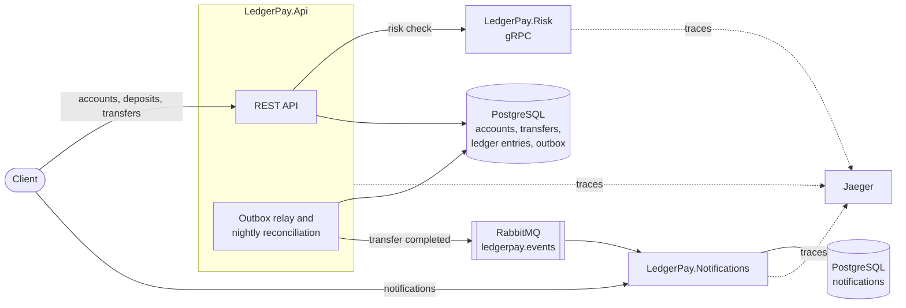

# LedgerPay

LedgerPay is a wallet and transfer API for Turkish lira, built with .NET 10, PostgreSQL, RabbitMQ and gRPC. Every movement of money is written into a double-entry ledger, so money is never created or lost. I built it to cover what goes wrong when money moves between accounts: two transfers spending the same balance at the same moment, a request sent twice, events lost between the database and the message broker, and a ledger that someone changed by hand.

[](https://github.com/hmzckd/ledgerpay/actions/workflows/ci.yml)

## What it includes

- Accounts without a balance column: a balance is the sum of the account's ledger entries
- Deposits and transfers that always write two ledger entries adding up to zero
- A row lock on the sender account, so two transfers cannot spend the same balance
- A required `Idempotency-Key` header, so a retried request moves money once
- A risk check over gRPC before every deposit and transfer, which fails closed
- `TransferCompleted` events published to RabbitMQ through an outbox, with publisher confirms
- A separate notification service that applies each event once and dead-letters unreadable ones
- A reconciliation run that proves the ledger still adds up, every night and on demand, once per night even with two copies of the API running
- One OpenTelemetry trace per transfer across all three services, shown in Jaeger
- Integration tests with Testcontainers (PostgreSQL, RabbitMQ) and a single `docker compose up` for everything

## How it fits together



A transfer, its two ledger entries and its `TransferCompleted` event are written to PostgreSQL in one transaction, so no event is sent for a transfer that was rolled back. The outbox relay publishes the events afterwards and retries until RabbitMQ confirms them. The risk check runs before that transaction, so a slow risk service never holds the sender's lock.

## How a transfer is recorded

Ali deposits 100.00 TRY and then sends 40.00 TRY to Ayşe. Amounts are stored in kuruş:

| Transfer | Account | Amount |
| --- | --- | --- |
| Deposit | External funding | -10000 |
| Deposit | Ali | +10000 |
| Transfer | Ali | -4000 |
| Transfer | Ayşe | +4000 |

Ali's balance is 6000, Ayşe's is 4000, and the external funding account, which stands for money outside LedgerPay, is at -10000. Every transfer adds up to zero, so the whole ledger always adds up to zero. That is what the reconciliation run checks.

## Stack

| Area | Technology |
| --- | --- |
| API | ASP.NET Core 10 Minimal API on .NET 10 |
| Database | PostgreSQL 17, EF Core 10 with Npgsql, EF Core migrations |
| Messaging | RabbitMQ 4.2 with RabbitMQ.Client 7, quorum queues |
| Service to service | gRPC (Grpc.AspNetCore, Protocol Buffers) |
| Tracing | OpenTelemetry, OTLP, Jaeger 2 |
| Tests | xUnit v3, WebApplicationFactory, Testcontainers, FakeTimeProvider |
| CI | GitHub Actions |

## Repository layout

```text
.
├── src/
│   ├── LedgerPay.Api/              accounts, deposits, transfers, outbox relay, reconciliation
│   ├── LedgerPay.Risk/             gRPC risk check
│   └── LedgerPay.Notifications/    listens to transfer events and stores notifications
├── tests/                          one test project per service
├── protos/risk.proto               the gRPC contract shared by the API and the risk service
├── docs/adr/                       architecture decision records
├── GLOSSARY.md                     domain terms
├── compose.yaml                    PostgreSQL, RabbitMQ, Jaeger and the three services
└── .github/workflows/ci.yml
```

## Run with Docker

Docker Desktop is the only requirement:

```powershell
docker compose up --build
```

The first build takes a few minutes. Then:

| What | Where |
| --- | --- |
| API | `http://localhost:5080` |
| Notifications | `http://localhost:5081` |
| Risk (gRPC) | `http://localhost:5082` |
| RabbitMQ management | `http://localhost:15672` (user and password `ledgerpay`) |
| Jaeger | `http://localhost:16686` |
| PostgreSQL | `localhost:5435` (user and password `ledgerpay`) |

### Try a transfer

In another window:

```powershell
$ali = Invoke-RestMethod -Method Post -Uri http://localhost:5080/api/accounts -ContentType "application/json" -Body '{"ownerName": "Ali"}'
$ayse = Invoke-RestMethod -Method Post -Uri http://localhost:5080/api/accounts -ContentType "application/json" -Body '{"ownerName": "Ayse"}'
Invoke-RestMethod -Method Post -Uri "http://localhost:5080/api/accounts/$($ali.id)/deposits" -ContentType "application/json" -Headers @{ "Idempotency-Key" = [guid]::NewGuid().ToString() } -Body '{"amount": 10000}'
$body = @{ fromAccountId = $ali.id; toAccountId = $ayse.id; amount = 4000 } | ConvertTo-Json
Invoke-RestMethod -Method Post -Uri http://localhost:5080/api/transfers -ContentType "application/json" -Headers @{ "Idempotency-Key" = [guid]::NewGuid().ToString() } -Body $body
Invoke-RestMethod "http://localhost:5080/api/accounts/$($ali.id)"
Invoke-RestMethod "http://localhost:5081/api/accounts/$($ayse.id)/notifications"
```

Ali's balance is `6000`, and within a few seconds Ayşe has the notification `You received 40.00 TRY.` A transfer over 50,000.00 TRY is rejected by the risk service with `422`.

`docker compose down -v` stops everything and deletes the data.

## Develop locally

With the .NET 10 SDK installed, start only the infrastructure and run the services from the source:

```powershell
docker compose up -d postgres rabbitmq jaeger
dotnet run --project src/LedgerPay.Risk
dotnet run --project src/LedgerPay.Api
dotnet run --project src/LedgerPay.Notifications
```

Each `dotnet run` goes in its own window. The services listen on the same ports as in Docker, and each service applies its database migrations on start.

## Checks

The tests need the .NET 10 SDK and a running Docker, because they start their own PostgreSQL and RabbitMQ containers:

```powershell
dotnet test
```

## API overview

| Method | Route | Purpose |
| --- | --- | --- |
| POST | `/api/accounts` | Open an account, `{ "ownerName": "Ali" }` |
| GET | `/api/accounts/{id}` | Get an account with its balance |
| GET | `/api/accounts/{id}/entries` | List an account's ledger entries |
| POST | `/api/accounts/{id}/deposits` | Deposit from the external funding account, `Idempotency-Key` header |
| POST | `/api/transfers` | Transfer between two accounts, `Idempotency-Key` header |
| GET | `/api/transfers/{id}` | Get a transfer |
| POST | `/api/reconciliation-runs` | Reconcile one day now, optional `{ "day": "2026-11-05" }`, yesterday by default |
| GET | `/api/reconciliation-runs/latest` | Get the latest reconciliation run |
| GET | `/health` | Health check (API and notifications) |
| GET | `/api/accounts/{id}/notifications` | List an account's notifications (notifications service, port 5081) |
| gRPC | `ledgerpay.risk.v1.RiskCheck/CheckTransfer` | Risk check (risk service, port 5082) |

Errors are returned as `application/problem+json`: 400 for invalid input, a missing `Idempotency-Key`, a transfer to the same account or one that involves the external funding account, and a reconciliation day in the future; 404 for an unknown account or transfer, or when no reconciliation has run yet; 409 for insufficient funds; 422 for an idempotency key reused with a different request and for a deposit or transfer the risk check rejected; 503 when the risk service is down or does not answer within one second. A request repeated with the same key and body gets the first transfer back with an `Idempotent-Replayed: true` header.

## Tracing

Each service sends its spans to Jaeger. One transfer shows up as one trace: the HTTP request, its SQL queries, the gRPC risk check, the wait in the outbox, the publish to RabbitMQ and the notification service storing the notification.

The relay publishes an event up to two seconds after the request has finished, so the trace context is stored with the outbox row and the relay continues the same trace from it. RabbitMQ.Client then carries it to the notification service in the message headers.

## Design decisions

Each decision has a short record in [`docs/adr/`](docs/adr/) with its reasons and consequences.

| ADR | Decision |
| --- | --- |
| [0001](docs/adr/0001-derive-balances-from-ledger-entries.md) | Balances are derived from ledger entries, which are never updated or deleted |
| [0002](docs/adr/0002-an-external-funding-account-balances-deposits.md) | An external funding account is the other side of every deposit |
| [0003](docs/adr/0003-lock-only-the-sender-account-during-a-transfer.md) | A transfer locks only the sender account, which is enough to stop overspending |
| [0004](docs/adr/0004-publish-events-with-rabbitmq-client-instead-of-masstransit.md) | Events are published with RabbitMQ.Client instead of MassTransit |
| [0005](docs/adr/0005-check-every-transfer-with-a-risk-service-over-grpc-and-fail-closed.md) | Every transfer is checked by a risk service over gRPC, and no money moves without an answer |

## Roadmap

- Authentication, so an owner can only see and move their own money
- Balance snapshots, so reading a balance does not sum an account's whole history
- More currencies
- Metrics next to the traces
- Building the Docker images in CI
